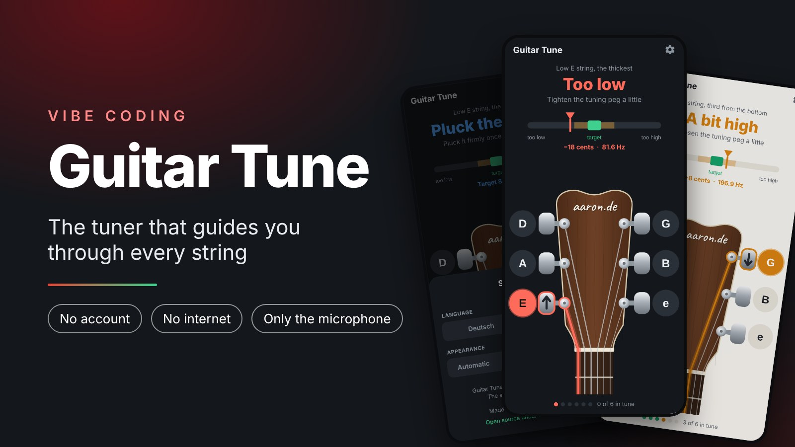
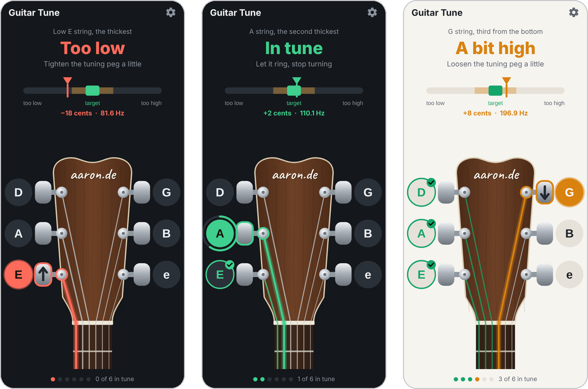
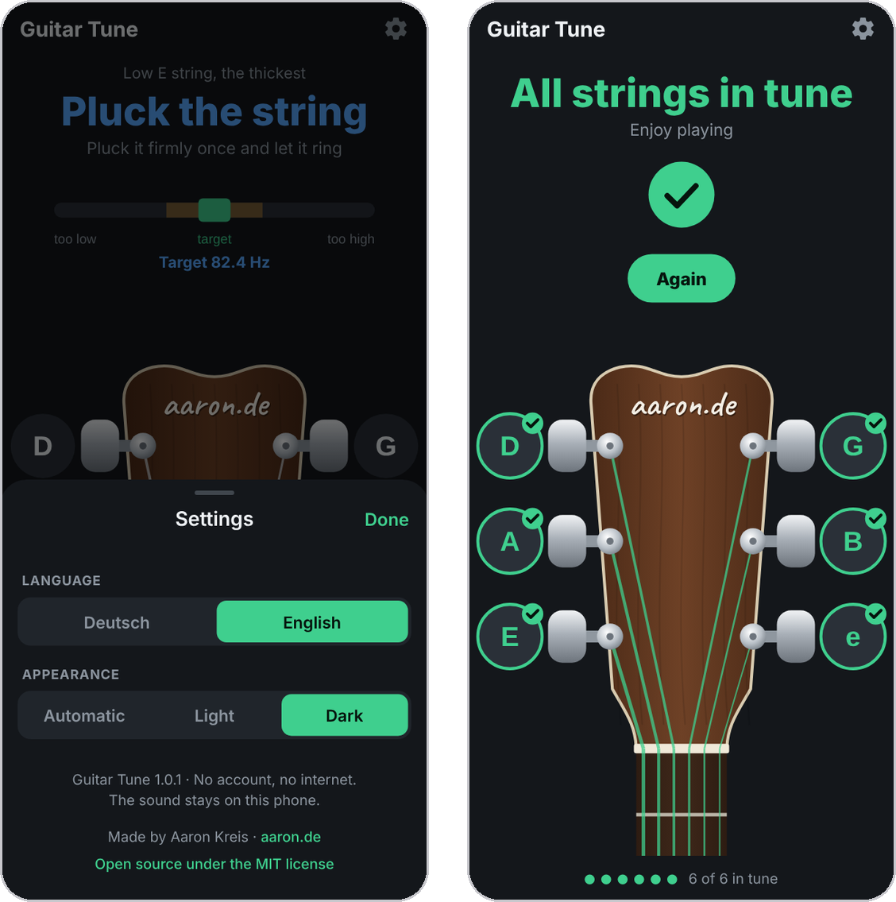

# Guitar Tune

<p align="center">
  
</p>

<p align="center">
  <b>A guitar tuner for Android that guides you through every string.</b><br>
  No account · No internet · Only the microphone · English and German
</p>

<p align="center">
  <a href="https://github.com/netperformance/GuitarTune/releases">Download APK</a> ·
  <a href="#english">English</a> ·
  <a href="#deutsch">Deutsch</a> ·
  <a href="LICENSE">MIT License</a>
</p>

<p align="center">
  
</p>

<p align="center">
  
</p>

## English

### About the app

Guitar Tune tunes a six string guitar in standard tuning (E A D G B E, A4 = 440 Hz) and does nothing else. The app shows which string to pluck, how far off it is and which tuning peg to turn in which direction. When a string stays in tune for one second, it gets a green tick and the app moves on to the next one. Made for beginners who do not yet know the names of the strings.

### Features

- **Guided tuning:** Starts with the low E string and goes on to A, D, G, B and high e. The small line at the top names the string in plain words ("Low E string, the thickest"). The string, its tuning peg and its button on the headstock are highlighted. Tap a button to jump to any string, also to retune one that is already done.
- **One colour, one meaning:** blue waits for a sound, red is more than 15 cents off, orange is 6 to 15 cents off, green is in tune (at most 5 cents). The big word, the pointer, the string, the peg, the button and the dot at the bottom always share the same colour. The word is always shown as well, so the app also works with red green colour blindness.
- **Direction:** An arrow on the tuning peg shows the way to turn: up to tighten, down to loosen. The sentence below the big word says the same ("Tighten the tuning peg a little").
- **Hold to confirm:** In tune means within 5 cents for one second. A ring around the button fills up meanwhile. Short gaps do not reset it.
- **Wrong string:** More than 3.5 semitones off usually means the wrong string was plucked. The app then asks "Far off. Is it the right string?"
- **Done:** After the high e string the app shows "All strings in tune" with an "Again" button and switches the microphone off.
- **Screen stays on** while tuning.
- **Settings:** language (German, English, or following the phone) and appearance (Automatic, Light, Dark; dark by default).

### Pitch detection

Most phone tuners measure the length of one vibration. On a steel string the overtones are slightly sharp, so these tuners read too high right after plucking and drift down while the string rings. A beginner then loosens a string that was already in tune. Guitar Tune measures the first 8 partials one by one and calculates the fundamental with the formula for stiff strings. Research, measurements and sources (German) are in [research/Recherche_Tonerkennung.md](research/Recherche_Tonerkennung.md).

1. **Coarse search** only around the expected string (±7 semitones, normalized square difference after McLeod). Octave errors cannot happen.
2. **Fine measurement** of the partials in the spectrum (Hann window, 8 times zero padding, parabolic interpolation), fitted to f_n = n·f0·√(1 + B·n²).
3. **Stiffness learned per string** during the first half second, then kept fixed.
4. **Attack skipped:** the first 120 ms after plucking are ignored, because the string sounds higher there. The last 5 readings are combined (median). Uncertain readings are dropped instead of shown.
5. **Microphone:** 48 kHz, source `UNPROCESSED` if the phone offers it, otherwise `VOICE_RECOGNITION`. Noise suppression, automatic gain and echo cancelling are switched off.

In the automatic tests with synthetic guitar tones (weak fundamental, stiff strings, 50 Hz hum, noise), 95 % of the readings are within 0.6 cents in a normal room and within 0.8 cents with loud background noise, without a single octave error. On a real guitar the result matched a second tuner app.

### Permissions

- **Microphone**, the only permission. The app explains why before Android asks.

The microphone only runs while the app is open and in the foreground. The sound is analysed in memory and never stored or sent. No internet, no ads, no tracking, no analytics. Android's automatic cloud backup is turned off (`allowBackup: false`).

### Install the APK

1. Copy the file to your phone (USB cable, or send it to yourself by mail or messenger).
2. Tap it in the Files app on your phone.
3. Android asks whether installing from this source is allowed. Allow it once.
4. Install. The app appears as "Guitar Tune" with a white guitar pick on red.

The APK runs on phones with a 64 bit processor (arm64) from Android 7 on.

### Build your own APK

```
bash scripts/build-apk.sh
```

Runs on Linux or WSL with Node.js 20+ and Java 17 to 21. The script sets up the Android SDK if needed, runs the type check, the app tests and the pitch detection tests, and writes the signed APK to `apk/`. The signing key lives in `signing/` (listed in `.gitignore`). Keep it safe: Android only installs an update if it is signed with the same key. Before an update, increase `version` and `versionCode` in `app.json`.

### Development

```
npm install
npm test
npm run typecheck
```

| Folder | Content |
|---|---|
| `src/domain/` | strings and frequencies, guided tuning, colour code and holding (with tests) |
| `src/ui/` | tuner screen, headstock, bar, settings, all texts in English and German in `i18n.ts` |
| `modules/pitch-detector/` | Android module in Kotlin: microphone and pitch detection, with tests on synthetic guitar tones |
| `research/` | research on pitch detection and the Python scripts used to compare methods |
| `scripts/` | `build-apk.sh` builds the APK, `icons.cjs` draws the app icons |

### License

Guitar Tune is open source under the MIT license, see [LICENSE](LICENSE).

## Deutsch

### Über die App

Guitar Tune stimmt eine sechssaitige Gitarre in Standardstimmung (E A D G H e, Kammerton 440 Hz) und macht sonst nichts. Die App zeigt, welche Saite du zupfen sollst, wie weit sie danebenliegt und welche Mechanik du in welche Richtung drehen musst. Stimmt eine Saite eine Sekunde lang, bekommt sie einen grünen Haken und die App geht zur nächsten. Gedacht für Anfänger, die die Namen der Saiten noch nicht kennen.

### Funktionen

- **Geführtes Stimmen:** Es beginnt mit der tiefen E Saite, dann folgen A, D, G, H und die hohe e Saite. Die kleine Zeile oben beschreibt die Saite in Alltagssprache („Tiefe E Saite, die dickste“). Die Saite, ihre Mechanik und ihr Knopf auf der Kopfplatte sind hervorgehoben. Ein Tipp auf einen Knopf springt zu dieser Saite, auch zu einer, die schon gestimmt ist.
- **Eine Farbe, eine Bedeutung:** Blau wartet auf einen Ton, Rot liegt mehr als 15 Cent daneben, Orange 6 bis 15 Cent, Grün stimmt (höchstens 5 Cent). Das große Wort, der Zeiger, die Saite, die Mechanik, der Knopf und der Punkt unten haben immer dieselbe Farbe. Das Wort steht immer dabei, damit die App auch bei Rot Grün Schwäche funktioniert.
- **Drehrichtung:** Ein Pfeil auf der Mechanik zeigt, wie herum gedreht wird: nach oben spannen, nach unten lockern. Der Satz unter dem großen Wort sagt dasselbe („Die Mechanik etwas spannen“).
- **Halten zum Bestätigen:** Stimmen heißt eine Sekunde lang höchstens 5 Cent daneben. Währenddessen füllt sich ein Ring um den Knopf. Kurze Lücken setzen ihn nicht zurück.
- **Falsche Saite:** Liegt der Ton mehr als 3,5 Halbtöne daneben, wurde meist die falsche Saite gezupft. Die App fragt dann „Sehr weit daneben. Ist es die richtige Saite?“
- **Fertig:** Nach der hohen e Saite zeigt die App „Alle Saiten gestimmt“ mit dem Knopf „Nochmal“ und schaltet das Mikrofon aus.
- **Der Bildschirm bleibt an**, solange gestimmt wird.
- **Einstellungen:** Sprache (Deutsch, Englisch, ohne eigene Wahl wie das Handy) und Darstellung (Automatisch, Hell, Dunkel; ohne eigene Wahl dunkel).

### Tonerkennung

Die meisten Stimmgeräte auf dem Handy messen die Dauer einer Schwingung. Bei einer Stahlsaite klingen die Obertöne etwas zu hoch, deshalb zeigen diese Stimmgeräte direkt nach dem Anschlag zu hohe Werte, die beim Ausklingen sinken. Ein Anfänger lockert dann eine Saite, die schon gestimmt war. Guitar Tune misst die ersten 8 Teiltöne einzeln und rechnet mit der Formel für steife Saiten auf den Grundton zurück. Recherche, Messwerte und Quellen stehen in [research/Recherche_Tonerkennung.md](research/Recherche_Tonerkennung.md).

1. **Grobsuche** nur im Bereich der erwarteten Saite (plus/minus 7 Halbtöne, Verfahren nach McLeod). Dadurch kann die App nicht in der Oktave danebenliegen.
2. **Feinmessung** der Teiltöne im Spektrum (Hann Fenster, achtfach aufgefüllt, Parabel durch die Spitze), ausgeglichen mit f_n = n·f0·√(1 + B·n²).
3. **Steifigkeit je Saite** wird in der ersten halben Sekunde gelernt und dann festgehalten.
4. **Anschlag überspringen:** Die ersten 120 ms nach dem Zupfen werden nicht ausgewertet, weil die Saite dort höher klingt. Die letzten 5 Messungen werden zusammengefasst (Median). Unsichere Messungen verwirft die App, statt sie anzuzeigen.
5. **Mikrofon:** 48 kHz, Quelle `UNPROCESSED`, wenn das Handy sie anbietet, sonst `VOICE_RECOGNITION`. Rauschunterdrückung, automatische Lautstärke und Echounterdrückung sind aus.

In den automatischen Tests mit künstlichen Gitarrentönen (schwacher Grundton, steife Saiten, Netzbrummen, Rauschen) liegen 95 % der Messungen in einem normalen Zimmer innerhalb von 0,6 Cent und bei lautem Hintergrund innerhalb von 0,8 Cent, ohne einen einzigen Oktavfehler. An einer echten Gitarre stimmte das Ergebnis mit einer zweiten Stimmgerät App überein.

### Berechtigungen

- **Mikrofon**, die einzige Berechtigung. Die App erklärt vorher, wofür sie es braucht.

Das Mikrofon läuft nur, solange die App offen und im Vordergrund ist. Der Ton wird im Arbeitsspeicher ausgewertet und weder gespeichert noch verschickt. Kein Internet, keine Werbung, kein Tracking, keine Auswertung. Die automatische Android Sicherung in Googles Cloud ist abgeschaltet (`allowBackup: false`).

### APK installieren

1. Die Datei aufs Handy kopieren (USB Kabel, oder per Mail oder Messenger an sich selbst).
2. Auf dem Handy in der Dateien App antippen.
3. Android fragt, ob die Installation aus dieser Quelle erlaubt sein soll. Einmal erlauben.
4. Installieren. Die App erscheint als „Guitar Tune“ mit einem weißen Plektrum auf Rot.

Die APK läuft auf Handys mit 64 Bit Prozessor (arm64) ab Android 7.

### Eigene APK bauen

```
bash scripts/build-apk.sh
```

Läuft unter Linux oder WSL mit Node.js ab 20 und Java 17 bis 21. Das Skript richtet bei Bedarf das Android SDK ein, prüft die Typen, die Tests der App und die Tests der Tonerkennung und legt die signierte APK in `apk/` ab. Der Signierschlüssel liegt in `signing/` (steht in `.gitignore`). Gut sichern: Android installiert ein Update nur, wenn es mit demselben Schlüssel signiert ist. Vor einem Update in `app.json` die `version` und den `versionCode` erhöhen.

### Entwickeln

```
npm install
npm test
npm run typecheck
```

| Ordner | Inhalt |
|---|---|
| `src/domain/` | Saiten und Frequenzen, geführtes Stimmen, Farbcode und Halten (mit Tests) |
| `src/ui/` | Stimmbildschirm, Kopfplatte, Balken, Einstellungen, alle Texte auf Deutsch und Englisch in `i18n.ts` |
| `modules/pitch-detector/` | Android Modul in Kotlin: Mikrofon und Tonerkennung, mit Tests an künstlichen Gitarrentönen |
| `research/` | Recherche zur Tonerkennung und die Python Skripte für den Vergleich der Verfahren |
| `scripts/` | `build-apk.sh` baut die APK, `icons.cjs` zeichnet die App Icons |

### Lizenz

Guitar Tune ist Open Source unter der MIT Lizenz, siehe [LICENSE](LICENSE).
